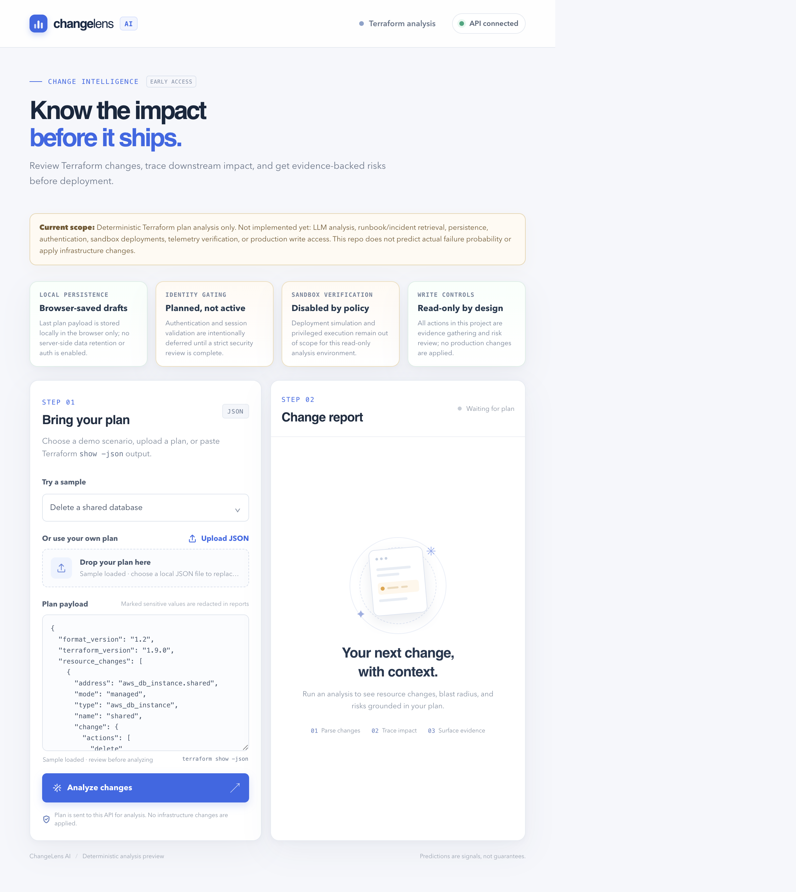

# ChangeLens AI

**Predict. Explain. Verify.**

ChangeLens is an infrastructure change intelligence project. This initial milestone analyzes Terraform plan JSON using deterministic parsing, dependency traversal, and explicit risk policies. It returns evidence references and uncertainty rather than pretending that a rule-based result is a calibrated failure probability.

## MVP status

Implemented:
- Terraform plan JSON parsing for resource addresses, action sequences, changed attributes, and configuration dependencies.
- Redaction for Terraform sensitive markers and explicit representation of unknown after-values.
- Dependency graph and transitive blast-radius traversal.
- Deterministic policies for deletion, replacement, common public exposure values, explicit encryption disablement, and decreased database connection limits.
- Structured report schema, FastAPI endpoint, interactive browser dashboard, CLI, fixtures, and tests.

Not implemented yet: LLM analysis, runbook/incident retrieval, persistence, authentication, sandbox deployments, telemetry verification, or production write access. This repository does not claim to predict actual failure probability or to apply infrastructure changes. The current implementation is intentionally read-only, deterministic, and approval-gated: it analyzes Terraform plans and surfaces evidence-backed risk signals without mutating infrastructure or invoking external privileged systems.

Current project scope:
- Deterministic Terraform plan analysis only.
- Local browser-saved drafts are allowed for convenience, but there is no server-side persistence, auth, or user account model.
- Authentication, identity gating, and telemetry verification are planned but intentionally disabled.
- Sandbox validation and deployment simulation remain out of scope for this read-only environment.
- This project never applies infrastructure changes and never claims actual risk probability; it surfaces structured, evidence-backed signals for human review.

## UI screenshots

## Requirements and setup

- Python 3.11 or newer
- Install the project and development tools: `python -m pip install ".[dev]"`

## Run

Analyze one of the checked-in plans:

`changelens fixtures/terraform_plans/delete_shared_database.json`

Start the API:

`uvicorn changelens.api:app --reload --app-dir src`

Open `http://127.0.0.1:8000/` for the dashboard. Choose a built-in demo plan or upload/paste a Terraform plan, then select **Analyze changes**. The interactive API docs are at `http://127.0.0.1:8000/docs`; the API also exposes `POST /analyze` and `GET /health`. Malformed plans receive a 422 response.

## Test and lint

- `pytest`
- `ruff check .`

## Fixtures

Six baseline inputs live under `fixtures/terraform_plans/`: metadata-only tag update, shared database deletion with declared downstream consumers, database connection-limit reduction, public-access configuration, encryption disablement, and resource replacement. Expected labels and rationale are in `fixtures/scenarios/scenarios.json`.

## Safety and limitations

Treat Terraform plan JSON as untrusted input. Do not upload secrets to shared systems. Terraform sensitive markers are redacted in normalized changed-attribute evidence, but callers should still protect raw plan files and API transport. The initial policy set is intentionally narrow; missing dependency metadata can cause an incomplete blast radius, and runtime workload data is not available to validate capacity risks.

## Six-week direction

The next planned milestones are broader deterministic tests, evidence-constrained AI explanations, then isolated sandbox verification and telemetry comparison. Authentication, audit logging, security scans, and benchmark expansion follow before any wider deployment. See [docs/architecture.md](docs/architecture.md) for current boundaries.
