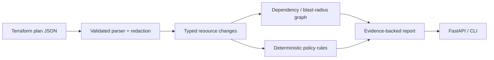

# Architecture (MVP)

The current implementation is a Python modular monolith. The parser normalizes planned actions and changed values, retaining Terraform JSON-pointer evidence references while redacting sensitive values and marking unknown values. The impact engine walks dependency edges declared in Terraform configuration. The policy engine emits findings for deletes, replacements, common public-access settings, explicit encryption disablement, and reduced database connection limits.

The API, CLI, and same-origin browser dashboard share the same orchestration function. The dashboard accepts pasted or uploaded JSON and displays deterministic findings, evidence references, uncertainties, changed attributes, and the computed blast radius. No AI provider, database, runbook retrieval, sandbox apply, telemetry ingestion, authentication, or production write path is implemented in this first milestone. Those capabilities require separate threat modeling and tests before introduction.
